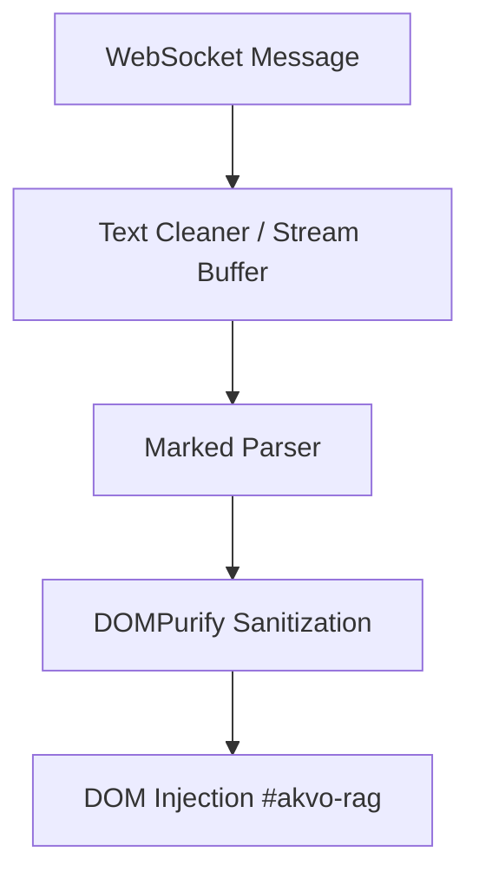

# Feature: [Feature Name]

> **Template Adaptation & Path Standard**:
> - **Project-Root-Relative Paths (#6)**: Always use paths relative to workspace root (e.g., `/src/chatbot.js`, `/tests/unit/...`, `agent_docs/features/...`). NEVER include local computer paths or usernames.
> - **Project Docs Root**: Saved to `agent_docs/features/{feature_name}.md` (and user stories to `agent_docs/stories/{story_name}.md`).

## Overview
[A brief explanation of the feature, its purpose, and what it achieves for the user/system.]

## User Stories Mapping
- [STORY-XXX]: As a user, I want [goal] so that [benefit].
- [STORY-YYY]: As a developer, I want [technical capability] so that [quality/reliability].

## Architecture & Component Design
[High-level architecture description, data flow, WebSocket messaging, or component lifecycle.]

1. **[Step 1]** → [Action/Request details]
2. **[Step 2]** → [Streaming/Text Processing details]
3. **[Step 3]** → [DOM Rendering / Event details]

---

## 1. Widget & Component Implementation

### 1.1 Touchpoint Files
- `[CREATE/MODIFY]` `/src/[component_file].js`
- `[CREATE/MODIFY]` `/src/scss/[styles].scss`
- `[TEST]` `/tests/unit/[test_file].test.mjs`

### 1.2 Component Lifecycle & Logic
**File**: `/src/[component_name].js`
- [Description of component methods, options, state handling, or WebSocket event listeners]
- [Cleanup logic in `destroy()` method]

### 1.3 Scoped Styling & Namespacing
**File**: `/src/scss/[stylesheet].scss`
- All classes MUST be prefixed with `akvo-`.
- All rules MUST be nested under `#akvo-rag`.
- CSS resets and font inheritance rules.

---

## 2. Requirements & Acceptance Criteria

### 2.1 Functional Requirements
- **Functional**: [Requirement 1]
- **Functional**: [Requirement 2]

### 2.2 User Acceptance Criteria (UAC)
- [ ] User can [action] and see [expected result].
- [ ] Visual styling remains isolated without affecting the host page.

### 2.3 Technical Acceptance Criteria (TAC)
- [ ] 100% of HTML output passes through `dompurify.sanitize()`.
- [ ] Internal imports use `.js` extension (Native ESM).
- [ ] Component cleans up all DOM nodes and event listeners on `destroy()`.

### 2.4 Constraints
- Maintain compatibility with `marked` and `dompurify`.
- Respect CSS namespacing and widget isolation rules (`#akvo-rag`).
- Zero unhandled secrets or sensitive tokens in client bundles.

---

## 3. Verification & Testing

### 3.1 Automated Tests
- **Run Tests**: `npm test`
- **Targeted Test**: `node --test tests/unit/[test_file].test.mjs`
- **Coverage Gate**: Maintain ≥80% test coverage.

### 3.2 Build Verification
- **Production Bundle**: `npm run build`
- Verify bundle output in `/dist/akvo-rag.js` and `/dist/akvo-rag.css`.

### 3.3 Manual Verification Steps
1. Run local dev server: `npm run dev`
2. Open test page in browser and test widget interactions.

---

## 4. Epic & Vibe Coding Estimation ⏱️

> Provide task estimates using the 3-part Vibe Coding breakdown: **Vibe Coding (Dev)** + **Automated Testing** + **QA & Review** = **Total Est. Time**. Break complex tasks down so that no single task exceeds 4 hours.
- Confidence Level: [High / Medium / Low]
- Dependencies: [e.g., None]

| Task ID | Story / Task Description | Vibe Coding (Dev) | Automated Testing | QA & Review | Total Est. Time | Priority |
| :--- | :--- | :---: | :---: | :---: | :---: | :--- |
| **TASK-01** | [Task description] | 25m | 20m | 15m | **60m (1.0h)** | P1 |
| **TASK-02** | [Task description] | 20m | 15m | 10m | **45m (0.75h)** | P2 |
