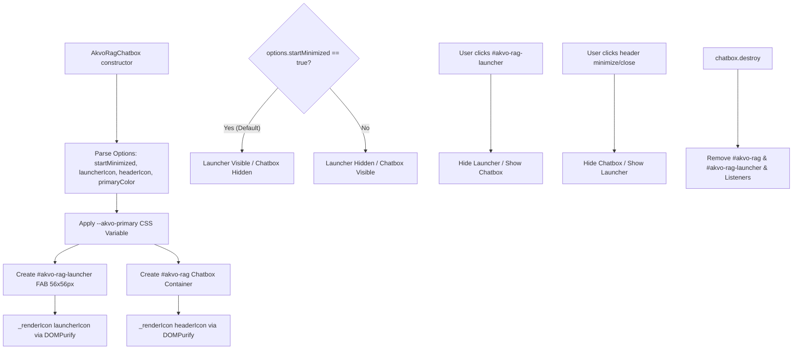

# Feature: [CHAT-001] akvo-rag-js Package Enhancement (Launcher & Custom UI)

> **Template Adaptation & Path Standard**:
> - **Project-Root-Relative Paths**: All paths relative to workspace root (`/src/chatbot.js`, `/src/scss/_launcher.scss`, `/tests/unit/launcher.test.mjs`, `agent_docs/features/16-launcher-custom-ui.md`).
> - **Issue Reference**: GitHub Issue [#16](https://github.com/akvo/akvo-rag-js/issues/16)
> - **Upstream Spec**: [IDC Academy AI Chatbot Integration Spec (CHAT-001)](https://github.com/akvo/IDH-IDC/blob/staging/docs/features/013_academy_ai_chatbot_integration_spec.md#chat-001-akvo-rag-js-package-enhancement-launcher--custom-ui)

---

## Overview
Modernize the `akvo-rag-js` embeddable widget with a floating circular launcher button (FAB), dynamic theme colors (`--akvo-primary`), and custom icon support (`launcherIcon`, `headerIcon`). This enables host applications (such as IDC) to mount the widget unobtrusively as a discrete 56x56px button at the bottom-right corner rather than an intrusive 360x500 open box, seamlessly harmonizing with the host application's brand identity.

---

## 5W1H Analysis
- **Who**: End users visiting host applications (e.g. IDC Academy), and frontend developers embedding `akvo-rag-js`.
- **What**: Floating action button launcher (`#akvo-rag-launcher`), `startMinimized` default option, customizable `launcherIcon` and `headerIcon` supporting SVG strings, image URLs, or CSS icon classes, dynamic `--akvo-primary` theming, and full unit test coverage.
- **Where**:
  - Logic: `/src/chatbot.js`
  - Styling: `/src/scss/_variables.scss`, `/src/scss/_launcher.scss`, `/src/scss/_chatbox.scss`, `/src/scss/main.scss`
  - Tests: `/tests/unit/launcher.test.mjs`, `/tests/unit/chatbot.test.mjs`
- **When**: Immediate milestone for IDC integration (CHAT-001).
- **Why**: The legacy widget defaulted to an expanded 360x500 box on page load with hardcoded blue styling and fixed icon, obstructing host page content and failing brand harmonization.
- **How**: Mount `#akvo-rag-launcher` alongside `#akvo-rag`. Handle visibility toggle with state management (`isMinimized` / `startMinimized: true`). Render sanitized icons with DOMPurify. Expose `--akvo-primary` CSS custom property and set inline styles when `options.primaryColor` is specified.

---

## User Stories Mapping
- **[STORY-017]**: As an IDC portal user, I want the AI chatbot to appear as a discrete floating launcher bubble in the bottom-right corner so that it does not block main page content until I choose to open it.
- **[STORY-018]**: As a developer embedding `akvo-rag-js`, I want to configure `primaryColor`, `launcherIcon`, and `headerIcon` so that the widget seamlessly reflects our host portal's visual identity.

---

## Architecture & Component Design



---

## 1. Widget & Component Implementation

### 1.1 Touchpoint Files
- `[MODIFY]` `/src/chatbot.js` (Launcher mounting, options, `_renderIcon`, toggle logic, style properties, `destroy` cleanup)
- `[MODIFY]` `/src/scss/_variables.scss` (Declare `--akvo-primary` fallback and default)
- `[MODIFY]` `/src/scss/_chatbot.scss` (Style `#akvo-rag-launcher`, pulse/hover states, positioning `bottom: 24px; right: 24px; z-index: 99998`, `--akvo-primary` integration)
- `[MODIFY]` `/src/scss/akvo-rag.scss` (Ensure styling imports)
- `[CREATE]` `/tests/unit/launcher.test.mjs` (DOM unit tests for launcher, toggling, icon rendering, CSS custom variables)

### 1.2 Component Lifecycle & Logic (`/src/chatbot.js`)
- **Options extension**:
  ```javascript
  {
    showLauncher: true, // Default: true. Set to false for classic box mode without floating launcher.
    startMinimized: true, // Default: true. Set to false to start expanded.
    primaryColor: '#007A78', // Optional primary color hex/rgb/name
    launcherIcon: null, // SVG string, image URL, or font icon class
    headerIcon: null, // SVG string, image URL, or font icon class
    ...
  }
  ```
- **Launcher DOM Element**:
  - Element ID: `#akvo-rag-launcher`
  - Position: `position: fixed; bottom: 24px; right: 24px; z-index: 99998; width: 56px; height: 56px; border-radius: 50%;`
- **Icon Rendering & Sanitization (`_renderIcon`)**:
  - If SVG (`<svg...`): sanitize via `DOMPurify.sanitize(val, { USE_PROFILES: { svg: true, svgFilters: true } })`.
  - If Image URL (`http://`, `https://`, `data:image/`, `.png`, `.svg`): sanitize src, render ``.
  - If Class (`fa ...` or custom): sanitize class attribute, render `<i class="..." aria-hidden="true"></i>`.
  - Default fallback: comment bubble icon.
- **State & Toggle Logic**:
  - `open()`: Shows `#akvo-rag`, hides `#akvo-rag-launcher`.
  - `close()` / `minimize()`: Hides `#akvo-rag`, shows `#akvo-rag-launcher`.
  - `destroy()`: Removes both `this.container` (`#akvo-rag`) and `this.launcher` (`#akvo-rag-launcher`) and detaches all bound event listeners.

### 1.3 Scoped Styling & Namespacing
- All CSS scoped under `#akvo-rag` and `#akvo-rag-launcher`.
- CSS variable: `--akvo-primary: #007A78;`
- Applies to:
  - `#akvo-rag-launcher`: `background-color: var(--akvo-primary, #007A78);`
  - `.akvo-chatbox-header`: `background-color: var(--akvo-primary, #007A78);`
  - `.akvo-send-button`: `background-color: var(--akvo-primary, #007A78);`
  - `.citation`: `color: var(--akvo-primary, #007A78);`

---

## 2. Requirements & Acceptance Criteria

### 2.1 User Acceptance Criteria (UAC)
- [ ] **UAC-1.1 (Floating Launcher Button)**: When `startMinimized: true` (or by default), `#akvo-rag-launcher` renders at bottom-right (`bottom: 24px; right: 24px; z-index: 99998`) as a 56x56px circular button without displaying the open chatbox.
- [ ] **UAC-1.2 (Toggle & Expand)**: Clicking the floating launcher smoothly displays the chatbox container (`#akvo-rag`) and hides the launcher.
- [ ] **UAC-1.3 (Minimize / Close)**: Clicking the close or minimize button in the chat header hides `#akvo-rag` and restores `#akvo-rag-launcher`.
- [ ] **UAC-1.4 (Custom Icon Support)**: When `launcherIcon` is passed, displays the custom SVG, image URL, or font icon; if omitted, defaults to a comment bubble.
- [ ] **UAC-1.5 (Header Avatar / Icon)**: When `headerIcon` is passed, an icon or avatar renders adjacent to the chat header title.
- [ ] **UAC-1.6 (Theme Color Harmonization)**: The launcher and chat header inherit `--akvo-primary` without hardcoded blue defaults.

### 2.2 Technical Acceptance Criteria (TAC)
- [ ] **TAC-1.1 (Backward Compatibility)**: Existing consumers with `{ title, kb_id, wsURL }` continue functioning seamlessly.
- [ ] **TAC-1.2 (Icon Prop Sanitization)**: `_renderIcon` safely renders SVG, img URL, or CSS classes, with 100% of inline HTML sanitized via DOMPurify ([SEC]).
- [ ] **TAC-1.3 (CSS Custom Variables)**: Uses `--akvo-primary` across SCSS files and sets inline style on elements when `options.primaryColor` is specified.
- [ ] **TAC-1.4 (Automated Unit Tests)**: Unit tests verify DOM creation, toggling, `startMinimized`, SVG/image/font-icon rendering branches, and `destroy()` cleanup.
- [ ] **TAC-1.5 (Build & Release Gate)**: `npm test` passes 100%; `npm run build` generates valid `dist/akvo-rag.js` and `dist/akvo-rag.css`.

---

## 3. Verification & Testing

### 3.1 Automated Tests
- `npm test` runs Node native test runner (`node --test tests/**/*.test.mjs`).
- `node --test tests/unit/launcher.test.mjs` targets new launcher and theming test suites.
- Coverage gate: maintain ≥80% test coverage.

### 3.2 Build Verification
- `npm run build` produces `dist/akvo-rag.js` and `dist/akvo-rag.css`.

---

## 4. Epic & Vibe Coding Estimation ⏱️

- **Confidence Level**: High
- **Dependencies**: None (`jsdom`, `dompurify` already present)

| Task ID | Story / Task Description | Vibe Coding (Dev) | Automated Testing | QA & Review | Total Est. Time | Priority |
| :--- | :--- | :---: | :---: | :---: | :---: | :--- |
| **TASK-01** | SCSS Theming & Launcher Styles (`_chatbot.scss`, `_variables.scss`, `--akvo-primary`) | 20m | 10m | 10m | **40m (0.67h)** | P1 |
| **TASK-02** | Launcher DOM Creation & Toggle State (`#akvo-rag-launcher`, `startMinimized`, `open`/`close`) | 25m | 20m | 15m | **60m (1.0h)** | P1 |
| **TASK-03** | Customizable Icons & DOMPurify Sanitization (`_renderIcon`, `launcherIcon`, `headerIcon`) | 25m | 20m | 15m | **60m (1.0h)** | P1 |
| **TASK-04** | Comprehensive Unit Tests (`tests/unit/launcher.test.mjs`, lifecycle & edge cases) | 15m | 30m | 15m | **60m (1.0h)** | P1 |
| **TASK-05** | Production Build & Package Version Verification (`npm run build`, `dist/`, `package.json`) | 15m | 10m | 15m | **40m (0.67h)** | P2 |
| **TOTAL** | **[CHAT-001] Package Enhancement** | **95m** | **90m** | **65m** | **250m (4.17h)** | - |
