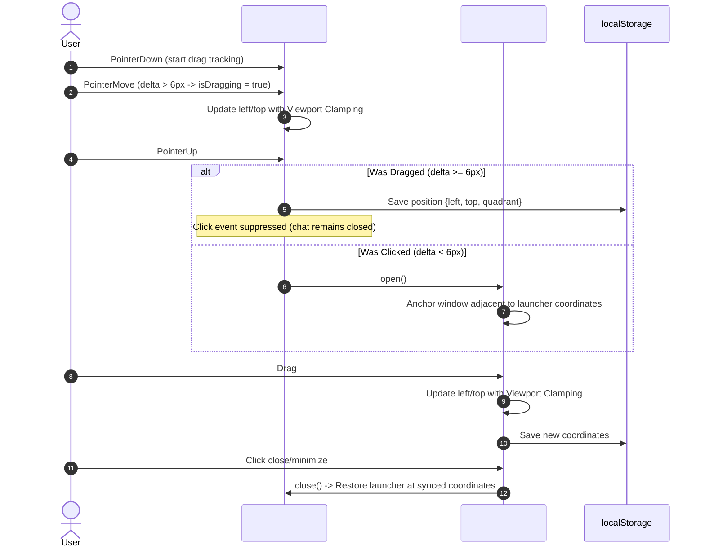
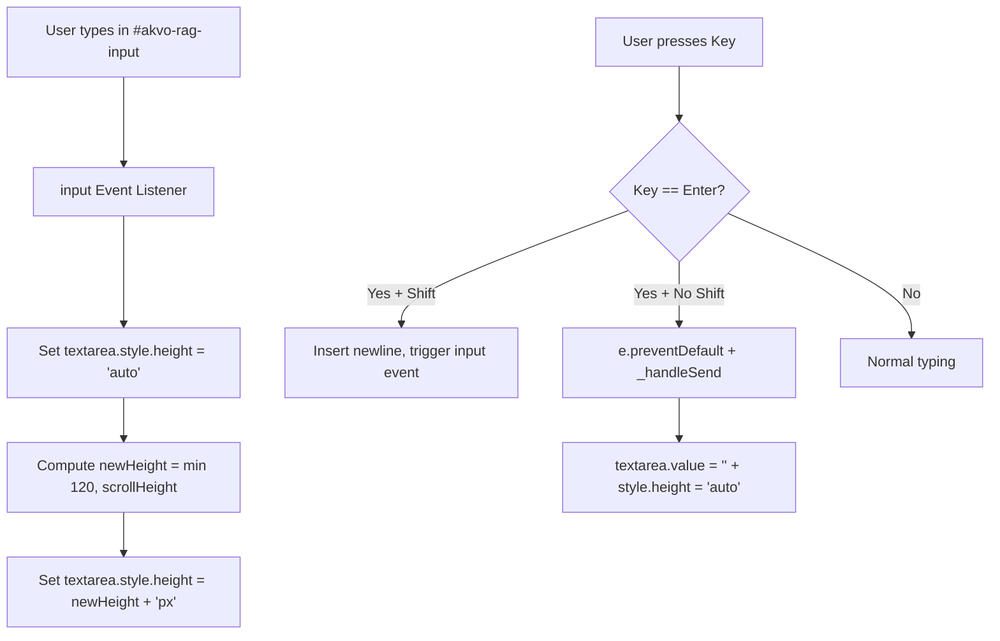

# Feature: [CHAT-002] akvo-rag-js Package Enhancement (Draggable Launcher/Window & Auto-Expanding Multiline Input)

> **Template Adaptation & Path Standard**:
> - **Project-Root-Relative Paths**: All paths relative to workspace root (`/src/chatbot.js`, `/src/scss/_chatbot.scss`, `/tests/unit/draggable.test.mjs`, `/tests/unit/textarea.test.mjs`, `agent_docs/features/18-draggable-multiline.md`).
> - **Issue Reference**: GitHub Issue [#18](https://github.com/akvo/akvo-rag-js/issues/18)

---

## Overview
Enhance the `akvo-rag-js` embeddable widget with:
1. **Draggable Launcher & Window with Persistence**: Users can drag the circular launcher button and chat window header to any screen quadrant. Position coordinates are clamped within viewport boundaries, dynamically anchored between launcher and window, and optionally persisted across page reloads via `localStorage`. A drag threshold ($\ge 6\text{px}$) prevents accidental click-to-open while dragging.
2. **Auto-Expanding Multiline Textarea**: Replaces the single-line text input with an auto-expanding `<textarea>` that smoothly grows from 1 line (~38px) up to ~120px (3–4 lines) as the user types long multi-sentence questions, with intuitive `Enter` (send) and `Shift+Enter` (newline) keyboard navigation.

---

## 5W1H Requirements Analysis
- **Who**: End users interacting with Akvo RAG across various desktop and mobile websites (especially users typing complex, multi-clause prompts or browsing content that the fixed bottom-right widget might obscure).
- **What**: 
  - Mouse and touch drag interactions on `#akvo-rag-launcher` and `#akvo-rag-header`.
  - Boundary clamping within `(0, 0)` and `(window.innerWidth - width, window.innerHeight - height)`.
  - $\ge 6\text{px}$ movement threshold separating click from drag.
  - Bidirectional position synchronization between launcher and chat window.
  - Position persistence via `localStorage` (configurable `storageKey: "akvo_rag_pos"` and `persistPosition: true`).
  - Auto-expanding `<textarea id="akvo-rag-input">` (min height ~38px, max height ~120px) with `scrollHeight` tracking and reset on send.
  - `Enter` to submit, `Shift+Enter` for newline.
- **Where**:
  - Logic: `/src/chatbot.js`
  - Styling: `/src/scss/_chatbot.scss`
  - Tests: `/tests/unit/draggable.test.mjs`, `/tests/unit/textarea.test.mjs`, `/tests/unit/chatbot.test.mjs`
  - Demo: `/public/index.html`
- **When**: Immediate enhancement for CHAT-002 milestone.
- **Why**: 
  - Fixed corner positioning frequently overlaps website sticky footers, floating action buttons, cookie banners, or primary UI elements.
  - Single-line `<input type="text">` truncates long RAG questions horizontally, making it difficult for users to review or edit paragraphs before submitting.
- **How**: 
  - Implement native pointer/touch dragging handlers directly on launcher and header elements, tracking `clientX/Y` and applying inline `style.left/top` with `style.bottom/right = 'auto'`.
  - Calculate quadrant offset when opening chatbox to anchor relative to launcher position.
  - Listen to `input` event on textarea to dynamically recalculate and assign `style.height = Math.min(120, textarea.scrollHeight) + 'px'`.

---

## User Stories Mapping
- **[STORY-019]**: As a site visitor, I want to drag the launcher button or open chat window out of the way of page content so that the chatbot never blocks critical page information.
- **[STORY-020]**: As a returning user, I want the chatbot to remember where I last dragged it so that I don't have to reposition it every time I navigate or reload.
- **[STORY-021]**: As an inquirer asking detailed questions, I want the input field to expand as I type multiple sentences so that I can easily read and edit my entire prompt before sending.

---

## Architecture & Component Design

### Dragging & Dynamic Anchoring Flow


### Multiline Textarea Auto-Resize Flow


---

## 1. Widget & Component Implementation Details

### 1.1 Touchpoint Files
- `[MODIFY]` `/src/chatbot.js` (Options parsing, drag handlers, positioning logic, textarea markup, keyboard events, `destroy()` cleanup)
- `[MODIFY]` `/src/scss/_chatbot.scss` (Draggable cursor styles, textarea multiline auto-expand styles, send button alignment)
- `[CREATE]` `/tests/unit/draggable.test.mjs` (Unit tests for drag threshold, clamping, persistence, quadrant anchoring)
- `[CREATE]` `/tests/unit/textarea.test.mjs` (Unit tests for textarea auto-resize, Enter vs Shift+Enter)
- `[MODIFY]` `/public/index.html` (Workbench playground controls for `draggable` and `persistPosition`)

### 1.2 Configuration Options
```javascript
const defaultOptions = {
  // Existing options
  startMinimized: true,
  showLauncher: true,
  primaryColor: "#007A78",
  position: "bottom-right",
  
  // New CHAT-002 options
  draggable: true,             // Enable/disable dragging of launcher and header
  persistPosition: true,       // Remember position in localStorage
  storageKey: "akvo_rag_pos",  // Key for localStorage persistence
  dragThreshold: 6,            // Minimum px movement to distinguish drag from click
};
```

### 1.3 Viewport Clamping & Window Anchoring
- **Boundary Clamping**:
  ```javascript
  const clamp = (val, min, max) => Math.max(min, Math.min(val, max));
  const newLeft = clamp(clientX - offsetX, 0, window.innerWidth - elementWidth);
  const newTop = clamp(clientY - offsetY, 0, window.innerHeight - elementHeight);
  ```
- **Quadrant-Aware Anchoring**:
  When expanding from a dragged launcher button at `(L_left, L_top)`:
  - If `L_left > window.innerWidth / 2` (Right half), anchor window to the right: `left = L_left + L_width - W_width`.
  - Else (Left half), anchor window to the left: `left = L_left`.
  - If `L_top > window.innerHeight / 2` (Bottom half), anchor window above: `top = L_top + L_height - W_height`.
  - Else (Top half), anchor window below: `top = L_top`.
  - Apply boundary clamping to the resulting window `(W_left, W_top)`.

### 1.4 Textarea Multiline Ergonomics
- Change `#akvo-rag-input` from `<input type="text">` to:
  ```html
  <textarea
    id="akvo-rag-input"
    rows="1"
    placeholder="Type a message..."
    autocomplete="off"
    autocorrect="off"
    autocapitalize="off"
    spellcheck="false"
  ></textarea>
  ```
- SCSS:
  ```scss
  #akvo-rag-input-container {
    align-items: flex-end; /* Keeps send button aligned to bottom as textarea expands */

    textarea {
      flex: 1;
      resize: none;
      min-height: 38px;
      max-height: 120px;
      line-height: 1.4;
      padding: 8px 12px;
      border-radius: 18px;
      overflow-y: auto;
    }
  }
  ```

---

## 2. Requirements & Acceptance Criteria

### 2.1 User Acceptance Criteria (UAC)
- [ ] **UAC-2.1 (Draggable Launcher Button)**: Users can grab and drag the launcher button anywhere across the screen using mouse or touch. Releasing after dragging moves the button without opening the chat window.
- [ ] **UAC-2.2 (Position Persistence)**: Reloading the page or navigating across pages remembers the last dragged position of the launcher and window via `localStorage`.
- [ ] **UAC-2.3 (Window Position Alignment)**: When the user clicks the launcher to open the chatbox, the window opens aligned to the launcher's quadrant position rather than jumping to the default bottom-right.
- [ ] **UAC-2.4 (Draggable Window Header)**: Users can drag the open chatbox by its header bar to reposition it. Closing the chatbox restores the launcher at that new location.
- [ ] **UAC-2.5 (Readable Long Text Input)**: Typing long questions wraps across multiple lines and expands the input box up to ~120px so users can read and edit their full question.
- [ ] **UAC-2.6 (Keyboard Shortcuts)**: Pressing `Enter` submits the chat, while `Shift+Enter` inserts a new line without submitting.

### 2.2 Technical Acceptance Criteria (TAC)
- [ ] **TAC-2.1 (Native DOM Implementation)**: Dragging and auto-expansion are implemented natively without heavy external libraries.
- [ ] **TAC-2.2 (Event Handling & Cleanup)**: Mouse and touch event listeners are properly registered on window-level and cleanly removed on `destroy()`.
- [ ] **TAC-2.3 (Textarea Auto-Resize)**: Height resizing happens via input event (`scrollHeight`), resetting cleanly on message dispatch without layout thrashing.
- [ ] **TAC-2.4 (Automated Tests)**: Unit tests verify launcher drag threshold, clamping, persistence, and textarea keyboard dispatch.
- [ ] **TAC-2.5 (Production Build)**: `npm test` passes 100%, and `npm run build` produces updated `dist/` bundles.

---

## 3. Verification & Testing

### 3.1 Automated Tests
- `npm test`
- `node --test tests/unit/draggable.test.mjs`
- `node --test tests/unit/textarea.test.mjs`
- Coverage gate: maintain $\ge 80\%$ test coverage.

### 3.2 Manual Verification Steps
1. Run `npm run dev`.
2. Open Workbench at `http://localhost:8080/`.
3. Drag launcher button across all 4 screen quadrants. Verify it does not open on release.
4. Click launcher button. Verify chat window opens adjacent to launcher.
5. Drag window header. Verify window repositions smoothly.
6. Refresh page. Verify launcher retains the saved position.
7. Paste a long 3-sentence prompt into input. Verify textarea expands up to 120px with scrollbar.
8. Press `Shift+Enter` (adds newline); press `Enter` (submits message and shrinks back to 38px).

---

## 4. Epic & Vibe Coding Estimation ⏱️

- **Confidence Level**: High
- **Dependencies**: None (Native DOM APIs & existing Webpack/Sass toolchain)

| Task ID | Story / Task Description | Vibe Coding (Dev) | Automated Testing | QA & Review | Total Est. Time | Priority |
| :--- | :--- | :---: | :---: | :---: | :---: | :--- |
| **TASK-01** | Draggable Launcher & Header with Threshold & Clamping | 30m | 20m | 15m | **65m (1.1h)** | P1 |
| **TASK-02** | Position Persistence & Dynamic Quadrant Anchoring | 25m | 20m | 10m | **55m (0.9h)** | P1 |
| **TASK-03** | Auto-Expanding Multiline `<textarea>` & Keyboard Navigation | 25m | 15m | 10m | **50m (0.8h)** | P1 |
| **TASK-04** | SCSS Styles, Layout Alignment & Workbench Controls | 20m | 10m | 10m | **40m (0.7h)** | P2 |
| **TASK-05** | E2E Regression, 80% Coverage Gate & Dist Build | 15m | 15m | 15m | **45m (0.75h)** | P1 |
| **TOTAL** | **Full CHAT-002 Epic Implementation** | **115m** | **80m** | **60m** | **255m (~4.25h)** | |
