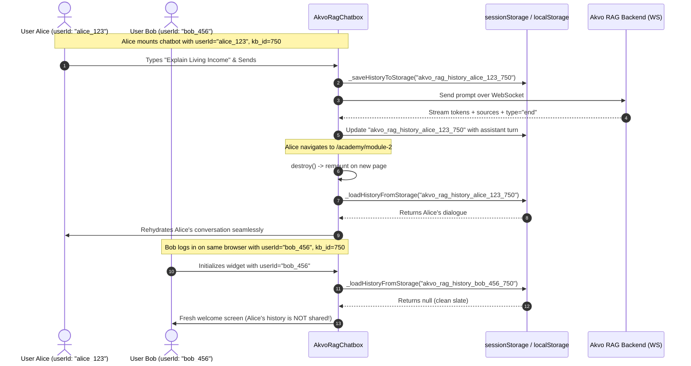

# Feature: [CHAT-003] Cross-Page Chat History Persistence & Citation Display Toggle

> **Template Adaptation & Path Standard**:
> - **Project-Root-Relative Paths**: All paths relative to workspace root (`/src/chatbot.js`, `/src/utils/citations-popover.js`, `/src/utils/chat-renderer.js`, `/tests/unit/history-persistence.test.mjs`, `/tests/unit/citations-toggle.test.mjs`).
> - **Issue Reference**: GitHub Issue [#20](https://github.com/akvo/akvo-rag-js/issues/20)

---

## Overview
Enhance the `akvo-rag-js` embeddable widget with two core architectural capabilities:
1. **Configurable Cross-Page Chat History Persistence with Strict User Isolation**:
   - In Single-Page Applications (e.g. React, Vue, Next.js) and multi-page websites, users frequently navigate between pages while conversing with the assistant. When navigating or refreshing, the chat history currently resets to empty because messages are held purely in memory.
   - This feature parameterizes history persistence on/off (`persistHistory: boolean`, default `true`).
   - **Multi-User Isolation**: Every user of the chatbot has an isolated transcript and never shares history. Storage keys are composite (`${historyStorageKey}_${userId || visitorId}_${kb_id}`), ensuring authenticated users (`options.userId`) and distinct anonymous visitors (`options.visitorId` / `this.visitorId`) have completely segregated storage partitions.
   - Automatically rehydrates previous conversation turns upon widget initialization with full DOMPurify sanitization.
2. **Configurable Citation Display Toggle (`showCitations: boolean`)**:
   - Some implementations (e.g. conversational companions, executive summaries, or clean chat modes) prefer conversational answers without inline numeric citation badges (`[citation:1]`) or popovers.
   - This toggle allows hosts to suppress citation rendering entirely by stripping citation tags cleanly via regex before final DOM rendering and skipping popover bindings.

---

## 5W1H Requirements Analysis
- **Who**: 
  - Host applications integrating `akvo-rag-js` (e.g. IDH Living Income Academy, Akvo portals) requiring seamless cross-route browsing while chatting.
  - End users exploring multi-page materials without losing their contextual question-and-answer log.
  - Multi-user environments (shared workstations, logged-in user transitions) where different users must NEVER see or share each other's dialogue history.
  - Product managers wanting fine-grained control over whether technical reference citations and popovers are exposed in the UI.
- **What**: 
  - **Parameterized History On/Off**: `options.persistHistory: boolean` (default: `true`). When `false`, history is strictly volatile in-memory; zero reads or writes to storage.
  - **Per-User Isolation**: Accepts `options.userId: string` (optional, for authenticated users). If omitted, falls back to `options.visitorId || this.visitorId` (anonymous persistent UUID from `getOrCreateVisitorId()`).
  - **Isolated Storage Key**: `${historyStorageKey}_${userScope}_${kb_id}` preventing any cross-user or cross-KB history pollution.
  - **Storage Mechanism**: Configurable `options.historyStorageType: "session" | "local"` (default: `"session"`).
  - **History Length Cap**: Configurable `options.maxHistoryMessages: number` (default: `20`) using a FIFO sliding window.
  - **Conversation Rehydration Engine**: Restores user questions and assistant answers upon `init()`.
  - **Public Lifecycle Methods**: `clearHistory()` to purge stored history for the current user and KB, and `getHistory()`.
  - **Citation Display Toggle**: `options.showCitations: boolean` (default: `true`). When `false`, strips all `\[citation:\d+\]` tags and skips popover triggers.
- **Where**:
  - History Persistence & Rehydration: `/src/chatbot.js`
  - User Identifier & Storage Isolation: `/src/chatbot.js`, `/src/utils/uuid.js`
  - Citation Transformation & Stripping: `/src/utils/citations-popover.js`, `/src/utils/chat-renderer.js`
  - Unit Tests: `/tests/unit/history-persistence.test.mjs`, `/tests/unit/citations-toggle.test.mjs`
  - Workbench Demo & Controls: `/public/index.html`
- **When**: Immediate implementation for CHAT-003 release.
- **Why**: 
  - Navigating pages in an SPA unmounts the chatbot component; losing conversational context breaks user momentum and forces redundant querying.
  - Shared browsers/terminals must protect privacy: User A logging in or chatting must never see User B's conversation.
  - `sessionStorage` guarantees that conversation transcripts do not persist after the browser tab is closed, mitigating PII/shared-device privacy risks.
  - Certain knowledge bases and user personas benefit from a clean, conversational tone without academic `[1]`, `[2]` citation tags.
- **How**: 
  - When `persistHistory: true`, serialize `{ role, content }` to Web Storage on user prompt submission and on assistant `end` event.
  - Format storage key: `${historyStorageKey}_${options.userId || this.visitorId}_${options.kb_id || "default"}`.
  - On `init()`, retrieve JSON array, validate structure, trim to `maxHistoryMessages`, and populate `#akvo-rag-body` via `appendMessageToBody` with DOMPurify sanitization.
  - Update `replaceCitations(el, citations, showCitations)`: when `showCitations === false`, strip `\[citation:\d+\]` with empty string `""` and skip popover generation.

---

## User Stories Mapping
- **[STORY-019]**: As a user navigating an SPA or multi-page portal, I want my chat conversation history to persist across page navigations and reloads, while ensuring that my history is isolated to my user account and never shared with other users.
- **[STORY-020]**: As an application developer, I want to configure whether chat history is saved (`persistHistory: true/false`) and whether citations are displayed (`showCitations: true/false`), so that I can tailor the widget experience to our portal's privacy and presentation requirements.

---

## Architecture & Component Design

### 1. Cross-Page History Persistence & Multi-User Isolation Flow



### 2. Citation Display Toggle Flow

```mermaid
flowchart TD
    A[Assistant Response Chunk / End Event] --> B{showCitations == true?}
    B -->|Yes (Default)| C[Execute replaceCitations]
    C --> D[Parse sources JSON]
    D --> E[Inject sup.citation badges with hover popovers]
    E --> F[Render HTML to DOM via DOMPurify]
    B -->|No (Disabled)| G[Strip citation tags: text.replace(/\\[citation:\\d+\\]/g, '')]
    G --> H[Skip popover attachment]
    H --> F
```

---

## 1. Widget & Component Implementation Details

### 1.1 Touchpoint Files
- `[MODIFY]` `/src/chatbot.js` (Add options parsing: `persistHistory`, `userId`, `historyStorageType`, `historyStorageKey`, `maxHistoryMessages`, `showCitations`; implement `_saveHistoryToStorage()`, `_loadHistoryFromStorage()`, `_rehydrateHistory()`, `clearHistory()`, `getHistory()`)
- `[MODIFY]` `/src/utils/citations-popover.js` (Support `showCitations: boolean` parameter in `replaceCitations()`; cleanly strip `\[citation:\d+\]` when false)
- `[MODIFY]` `/src/utils/chat-renderer.js` (Pass through citation toggle options if applicable)
- `[CREATE]` `/tests/unit/history-persistence.test.mjs` (Unit tests for on/off persistence, user isolation, sliding window, rehydration, `clearHistory()`)
- `[CREATE]` `/tests/unit/citations-toggle.test.mjs` (Unit tests for citation badge rendering vs regex stripping)
- `[MODIFY]` `/public/index.html` (Workbench playground controls for `persistHistory`, `userId`, and `showCitations`)

### 1.2 Configuration Options
```javascript
const defaultOptions = {
  // Existing options
  startMinimized: true,
  showLauncher: true,
  primaryColor: "#007A78",
  position: "bottom-right",
  draggable: true,
  persistPosition: true,
  storageKey: "akvo_rag_pos",
  dragThreshold: 6,
  
  // New CHAT-003 options: History Persistence & User Isolation
  persistHistory: true,                  // boolean: on/off switch for cross-page dialogue persistence
  userId: null,                          // string | null: authenticated user ID (falls back to visitorId)
  historyStorageType: "session",         // "session" | "local": Web Storage backend
  historyStorageKey: "akvo_rag_history", // string: base key name in storage
  maxHistoryMessages: 20,                // number: maximum conversation messages preserved in sliding window
  
  // New CHAT-003 options: Citation Display Toggle
  showCitations: true                    // boolean: toggle inline citation badges and hover popovers
};
```

### 1.3 User-Isolated Storage Key Generation
```javascript
_getHistoryStorageKey() {
  const userScope = String(this.options.userId || this.visitorId || "anon").trim();
  const kbScope = String(this.options.kb_id || "default").trim();
  const baseKey = String(this.options.historyStorageKey || "akvo_rag_history").trim();
  return `${baseKey}_${userScope}_${kbScope}`;
}
```

### 1.4 Citation Stripping Logic
When `showCitations === false`:
```javascript
export function replaceCitations(el, citations, showCitations = true) {
  if (!el) return;
  if (!showCitations) {
    // Strip all [citation:ID] patterns completely without leaving residual brackets or spaces
    el.innerHTML = el.innerHTML.replace(/\[\s*citation:\s*\d+\s*\]/gi, "");
    return;
  }
  // Standard citation badge replacement and popover attachment...
}
```

---

## 2. Requirements & Acceptance Criteria

### 2.1 User Acceptance Criteria (UAC)
- [ ] **UAC-3.1 (Parameterized On/Off History)**: When `persistHistory: true`, messages persist across page reloads/routes. When `persistHistory: false`, dialogue is strictly in-memory and does not write to or read from storage.
- [ ] **UAC-3.2 (Strict Multi-User Isolation)**: Different users (`userId` or different `visitorId`) NEVER share history. Mounting the widget for User B shows an empty history, and User A's history remains partitioned.
- [ ] **UAC-3.3 (Cross-Page Rehydration)**: Navigating to a new route in an SPA rehydrates past messages seamlessly in the same order, scrolling to the latest message.
- [ ] **UAC-3.4 (Sliding Window Limit)**: Preserved history is capped at `maxHistoryMessages` (default 20), dropping oldest turns when exceeded.
- [ ] **UAC-3.5 (Public History APIs)**: `chatbox.clearHistory()` deletes the stored history for the active user/KB and empties memory; `chatbox.getHistory()` returns current conversation turns.
- [ ] **UAC-3.6 (Citation Toggle)**: When `showCitations: false`, assistant answers strip all `[citation:X]` tags; no `<sup>` badges or popovers appear. When `true`, citation badges and popovers render normally.

### 2.2 Technical Acceptance Criteria (TAC)
- [ ] **TAC-3.1 (Storage Key Parity)**: Key format `${historyStorageKey}_${userScope}_${kb_id}` enforced across read, write, and clear operations.
- [ ] **TAC-3.2 (XSS Sanitization on Rehydrate)**: Rehydrated messages pass through `DOMPurify.sanitize(marked.parse(text))` identically to live messages.
- [ ] **TAC-3.3 (Storage Quota Resilience)**: All storage operations wrapped in `try/catch` to handle private browsing, disabled cookies, or quota limits gracefully.
- [ ] **TAC-3.4 (Clean Regex Stripping)**: Regex cleanly removes `[citation:X]` even with internal whitespace variations without breaking adjacent markdown text.
- [ ] **TAC-3.5 (Quality Gate)**: `npm test` passes 100% with $\ge 80\%$ test coverage maintained across domain logic.

---

## 3. Verification & Testing

### 3.1 Automated Tests
- `npm test`
- `node --test tests/unit/history-persistence.test.mjs`
- `node --test tests/unit/citations-toggle.test.mjs`
- Coverage gate: maintain $\ge 80\%$ test coverage.

### 3.2 Manual Verification Steps
1. Run `npm run dev`.
2. Open Workbench at `http://localhost:8080/`.
3. Send a message with `persistHistory: true` and `userId: "user_alice"`. Refresh the page — verify message is restored.
4. Switch `userId` to `"user_bob"` on the Workbench — verify chat window is fresh and does NOT show Alice's messages.
5. Set `persistHistory: false` — send a message, refresh page, verify history is not preserved.
6. Toggle `showCitations: false` — send a question yielding citations, verify response text contains no `[citation:1]` tags or superscript popovers.
7. Click "Clear History" button — verify active conversation history is purged from storage.

---

## 4. Epic & Vibe Coding Estimation ⏱️

- **Confidence Level**: High
- **Dependencies**: None (Native Web Storage APIs, DOMPurify, existing test harness)

| Task ID | Story / Task Description | Vibe Coding (Dev) | Automated Testing | QA & Review | Total Est. Time | Priority |
| :--- | :--- | :---: | :---: | :---: | :---: | :--- |
| **TASK-01** | Parameterized History & Multi-User Isolated Storage Keys (`_saveHistoryToStorage`, `_loadHistoryFromStorage`) | 25m | 15m | 10m | **50m (0.83h)** | P1 |
| **TASK-02** | Conversation Rehydration Engine & Public APIs (`clearHistory`, `getHistory`) | 20m | 15m | 10m | **45m (0.75h)** | P1 |
| **TASK-03** | Configurable Citation Display Toggle (`showCitations: boolean` & regex stripping) | 20m | 15m | 10m | **45m (0.75h)** | P1 |
| **TASK-04** | Comprehensive Unit Tests (`history-persistence.test.mjs`, `citations-toggle.test.mjs`) | 15m | 30m | 15m | **60m (1.0h)** | P1 |
| **TASK-05** | Workbench Playground Controls, Regression Pass & Dist Build | 15m | 15m | 10m | **40m (0.67h)** | P2 |
| **TOTAL** | **Full CHAT-003 Epic Implementation** | **95m** | **90m** | **55m** | **240m (~4.0h)** | |
